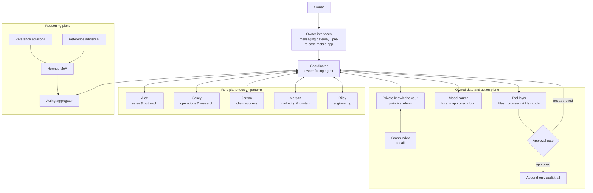
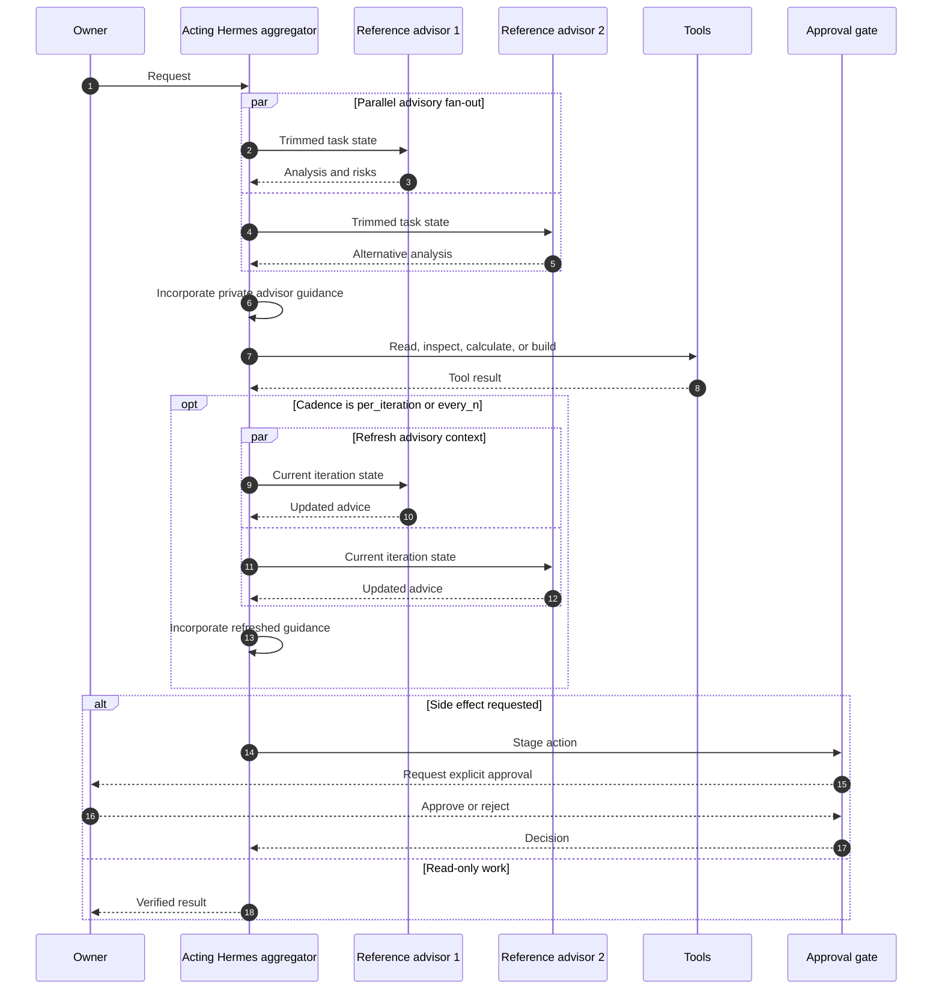
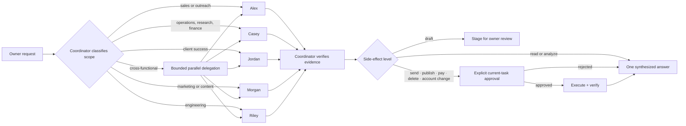
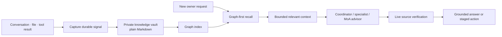
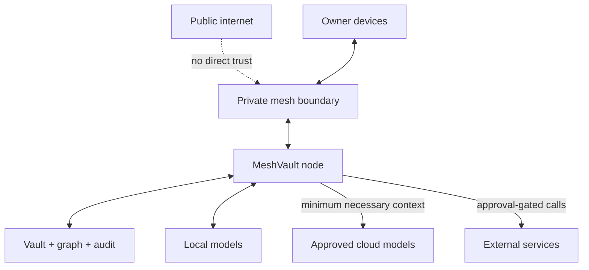

# MeshVault agentic architecture

A written reference for engineers designing multi-agent systems that keep one accountable agent and a human approval step. It describes the mixture-of-agents (MoA) and role-based orchestration patterns behind MeshVault, with Mermaid diagrams.

> **Status:** documentation only. This repository contains this README and a license. There is no code, configuration, or package to install or run. MeshVault's own apps are pre-release and are not part of this repository.

## What is implemented and what is design

| Part | State | Where it lives |
|---|---|---|
| MoA loop (advisors plus one acting aggregator) | Implemented and public | [Hermes Agent](https://github.com/NousResearch/hermes-agent), documented in [Mixture of Agents](https://hermes-agent.nousresearch.com/docs/user-guide/features/mixture-of-agents) |
| Coordinator with specialist roles | Design pattern | MeshVault ran five named specialist roles in 2026 and no longer deploys them. The pattern is kept here as a reference. |
| Private Markdown vault with graph recall | In use at MeshVault, private | Not published here |
| Approval levels L0 to L3 and append-only audit trail | Design intent | Not published here |
| Client apps | Pre-release | Not published here |

Everything outside the MoA loop describes how MeshVault intends the system to behave. Nothing in this repository proves that behavior.

## Why this exists

A useful agent system needs more than a large model. It needs several kinds of judgment, a single accountable operator, durable context, constrained tools, and explicit gates before real-world side effects.

The architecture combines two orchestration layers:

1. **Mixture of Agents (MoA)** gives the acting agent diverse model advice before it decides what to do.
2. **Role orchestration** lets a coordinator delegate bounded work to specialists and return one verified answer to the owner.

MoA adds several model perspectives to one decision. Role orchestration splits work by scope while one coordinator stays accountable for the result.

## System view

## Hermes MoA loop

[Hermes Agent](https://github.com/NousResearch/hermes-agent) implements MoA as a virtual model provider. Each named preset appears as a selectable model under the `moa` provider. Reference models are advisors: they get a trimmed view of the current task state, no tool schemas, and a system prompt that tells them they cannot act. Their calls run in parallel. The acting aggregator then receives their output as private guidance and continues the normal agent and tool loop.

The aggregator is the sole acting model. Many models can advise, but only one agent owns the task and its side effects.

The approval gate at the end of this diagram is MeshVault's design layer. Hermes MoA itself does not stage actions for approval.

### Runtime properties

These match the Hermes Agent source (`agent/moa_loop.py`, `hermes_cli/moa_config.py`) as of October 2026.

- Reference calls fan out concurrently in a thread pool capped at 8 workers.
- Advisors cannot use tools and do not act on the user's behalf.
- The aggregator is the acting model and keeps Hermes's normal tool loop.
- A failed advisor call becomes a `[failed: ...]` note. Successful responses stay usable, the aggregator is told which references were unavailable (unless `degraded_reference_policy` is `silent`), and the turn continues. If every advisor fails, the aggregator acts alone.
- The `fanout` setting controls cadence: `user_turn` (the default) runs advisors once per user turn, `per_iteration` runs them on every tool iteration, and `every_n:<N>` runs them on the first iteration and then every Nth.
- Advisors see tool calls in full and tool results as head-and-tail previews of up to 4,000 characters. The acting agent keeps the full transcript.
- A preset cannot use another MoA preset as a model. Recursive MoA is blocked.
- Full MoA traces are opt-in through `moa.save_traces`.
- Token usage and estimated cost are recorded for each advisor and the aggregator, priced at each model's own rate.

## Role orchestration

This section is a design pattern. MeshVault no longer deploys the five named roles below.

The coordinator is the sole owner-facing agent. The specialists are bounded workers, not independent public personas and not competing orchestrators.

### Specialist contract

| Role | Primary scope | Default boundary |
|---|---|---|
| Coordinator | Coordination, verification, owner communication | One accountable final answer |
| Alex | Sales and outreach | Draft or stage outbound work unless approved |
| Casey | Operations, research, finance | Evidence first; money movement remains gated |
| Jordan | Client success | Customer context with outbound actions gated |
| Morgan | Marketing and content | Draft freely; publishing remains gated |
| Riley | Engineering | Build and verify; deployments and destructive changes remain gated |

The coordinator treats specialist responses as untrusted input until it verifies them against live state or primary sources.

## Context and memory

The vault is the durable source of knowledge. The graph index narrows retrieval before raw documents are opened. Live systems remain the source of truth for current account, service, deployment, and network state.

## Approval model

Design intent. No enforcement code for these levels is published here.

| Level | Example | Default behavior |
|---|---|---|
| L0 | Read, search, inspect, calculate | May run automatically |
| L1 | Draft, plan, summarize | May produce a staged artifact |
| L2 | Send, publish, deploy, change an account | Requires explicit current-task approval |
| L3 | Payment, destructive action, security/credential change | Requires deliberate approval and post-action verification |

Delegation does not transfer authority. Every worker inherits the same action boundary as the coordinator.

## Trust boundaries

Design principles:

- Private mesh before public exposure.
- Local-first data and inference where practical.
- Minimum necessary context for cloud model calls.
- Explicit approval before external side effects.
- Append-only audit evidence for actions.
- One accountable coordinator even when many models or specialists contribute.

## What MoA is good for

MoA is useful when the cost of a shallow answer is higher than the cost of additional inference:

- architecture and security reviews
- ambiguous engineering decisions
- cross-functional plans
- adversarial critique before a high-impact action
- synthesis where models have meaningfully different strengths

It is a poor default for trivial lookups, deterministic calculations, or urgent low-risk tasks. More agents can add cost and correlated noise without adding insight.

## Decision record

The architecture uses **one acting coordinator with advisory fan-out** instead of several autonomous writers.

Why:

1. A single actor preserves a clear audit trail.
2. Advisory models can disagree without racing to mutate state.
3. Tool authority stays in one policy boundary.
4. Specialist work can be parallelized while final verification remains centralized.
5. Failure degrades to partial advice instead of conflicting side effects.

The trade-off is added latency and model cost. The design reserves MoA for decisions where diversity of judgment is worth paying for.

## Sources

- MoA behavior: the [Hermes Agent repository](https://github.com/NousResearch/hermes-agent) and its [Mixture of Agents documentation](https://hermes-agent.nousresearch.com/docs/user-guide/features/mixture-of-agents).
- Role orchestration, memory, and approval model: MeshVault's private design notes, which are not published.

No credentials, private paths, internal addresses, customer data, or proprietary implementation details are included.

## License

MIT. See [LICENSE](LICENSE).
