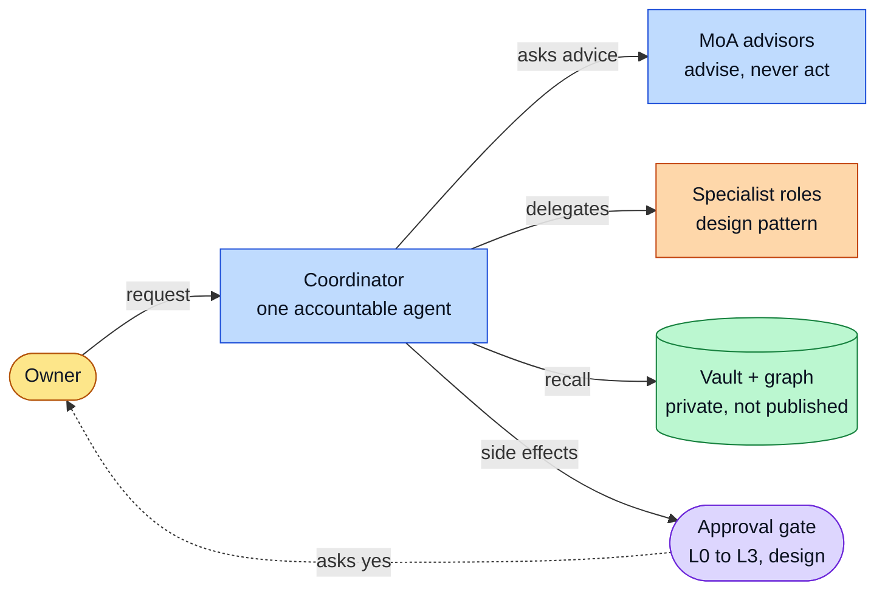
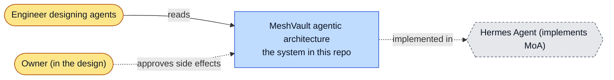
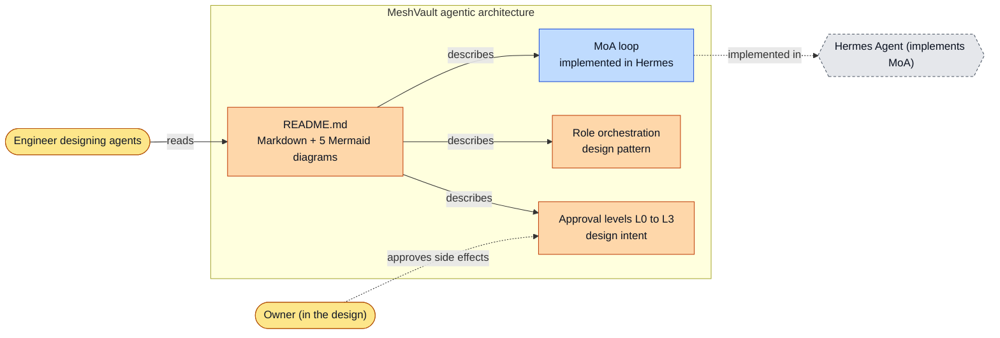
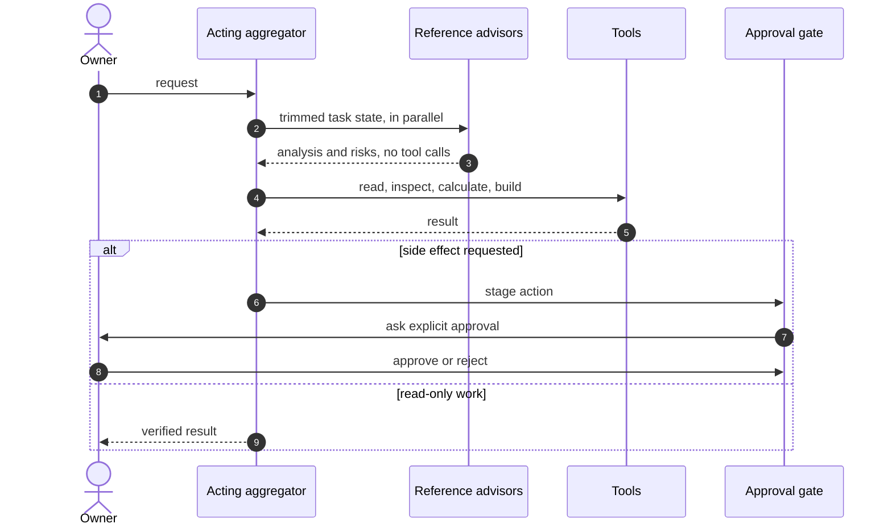

# MeshVault agentic architecture: architecture

<!-- arch-kit:generated -->

> Whiteboard-level structure: what systems exist, what they talk to, and when they run. Evidence-backed; every box below maps to a path listed in [Evidence](#10-evidence).
> Generated by the ArchDocs kit from repo commit `3b95eb8312`. Diagram sources: [`architecture/*.mmd`](architecture/). Hi-res renders sit next to each source.

## 1. Purpose

This repository is a document, not software. It describes a mixture-of-agents (MoA) loop and a role-orchestration pattern in which several advisory models and bounded specialists feed one accountable coordinator, with human approval before any side effect. Only the MoA loop is implemented, in Hermes Agent; the roles, approval levels, vault and audit trail are design intent. The repo holds `README.md` and a license. There is no code to run.

## 2. Whiteboard view

Six boxes. Many models may advise; exactly one agent acts, and consequential actions stop at a gate.

Hi-res: [SVG](architecture/whiteboard.svg) · [PNG 3x](architecture/whiteboard@3x.png) · [dark SVG](architecture/whiteboard.dark.svg) · [dark PNG 3x](architecture/whiteboard.dark@3x.png)

Explorable version (Archify, standalone HTML, download and open locally): [`architecture/meshvault-agentic-architecture.archify.html`](architecture/meshvault-agentic-architecture.archify.html)

## 3. System context (C4 level 1)

Who and what touches the system from outside.

Hi-res: [SVG](architecture/context.svg) · [PNG 3x](architecture/context@3x.png)

## 4. Containers and components (C4 level 2)

The parts that run or hold data inside the repo's system boundary.

Hi-res: [SVG](architecture/containers.svg) · [PNG 3x](architecture/containers@3x.png)

| Container | Kind | Tech | What it does | Evidence |
|---|---|---|---|---|
| README.md | doc | Markdown + 5 Mermaid diagrams | System view, MoA loop, role orchestration, context and memory, trust boundaries, decision record. | [`README.md#L30-L246`](../README.md#L30-L246) |
| MoA loop | app | implemented in Hermes | Parallel advisors (max 8 workers) feed one acting aggregator. | [`README.md#L81-L144`](../README.md#L81-L144) |
| Role orchestration | doc | design pattern | Coordinator plus five bounded specialists. No longer deployed. | [`README.md#L146-L195`](../README.md#L146-L195) |
| Approval levels L0 to L3 | doc | design intent | Read, draft, send/publish, pay/destroy. No enforcement code published here. | [`README.md#L214-L225`](../README.md#L214-L225) |

## 5. Key runtime sequences

### 5.1 Hermes MoA turn with an approval gate

The gate in this diagram is the design layer. Hermes MoA itself does not stage actions for approval (README.md line 130).

Hi-res: [SVG](architecture/sequence-1.svg) · [PNG 3x](architecture/sequence-1@3x.png)

## 6. Data flow and stores

No implemented data store here. The design places a plain-Markdown vault and a graph index beside the coordinator, with an append-only audit trail; none of that is published in this repo (README.md lines 9-15).

## 7. Deployment and runtime topology

Nothing is deployed. The repo is read on GitHub. Deployment topology in the document (private mesh, owner devices, MeshVault node, local and approved cloud models) is design intent only.

## 8. Failure modes and how to see them

| Failure | What the user sees | How to see it | Evidence |
|---|---|---|---|
| Reader treats design intent as implemented behavior | Wrong expectations about enforcement | The status table separates implemented (MoA loop) from design (roles, approval levels, vault, audit) | [`README.md#L7-L17`](../README.md#L7-L17) |
| One advisor fails (documented MoA behavior) | Turn continues with a [failed: ...] note; if all fail the aggregator acts alone | Aggregator is told which references were unavailable unless degraded_reference_policy is silent | [`README.md#L139`](../README.md#L139) |
| Specialist output is wrong | Coordinator treats it as untrusted input until verified | Verification against live state or primary sources | [`README.md#L195`](../README.md#L195) |

## 9. State machine

No state machine in this repo. The document describes request and approval flows as diagrams, not as a lifecycle of an entity.

## 10. Evidence

Every path below exists at the pinned commit; links are relative to `docs/`.

| Path | Why it matters |
|---|---|
| [`README.md#L7-L17`](../README.md#L7-L17) | What is implemented and what is design. |
| [`README.md#L30-L79`](../README.md#L30-L79) | System view diagram. |
| [`README.md#L81-L144`](../README.md#L81-L144) | Hermes MoA loop, sequence diagram and runtime properties. |
| [`README.md#L146-L195`](../README.md#L146-L195) | Role orchestration and specialist contract. |
| [`README.md#L214-L255`](../README.md#L214-L255) | Approval model and trust boundaries. |
| [`LICENSE`](../LICENSE) | MIT. |

Graphify (local AST, no LLM) read this repo: 16 nodes, 15 edges, 3 communities. Most connected: `MeshVault agentic architecture` (13), `Hermes MoA loop` (2), `Role orchestration` (2), `What is implemented and what is design` (1), `Why this exists` (1).

- Report: [`architecture/graphify/GRAPH_REPORT.md`](architecture/graphify/GRAPH_REPORT.md)
- Interactive graph: [`architecture/graphify/graph.html`](architecture/graphify/graph.html) (30 KB, download and open locally)
